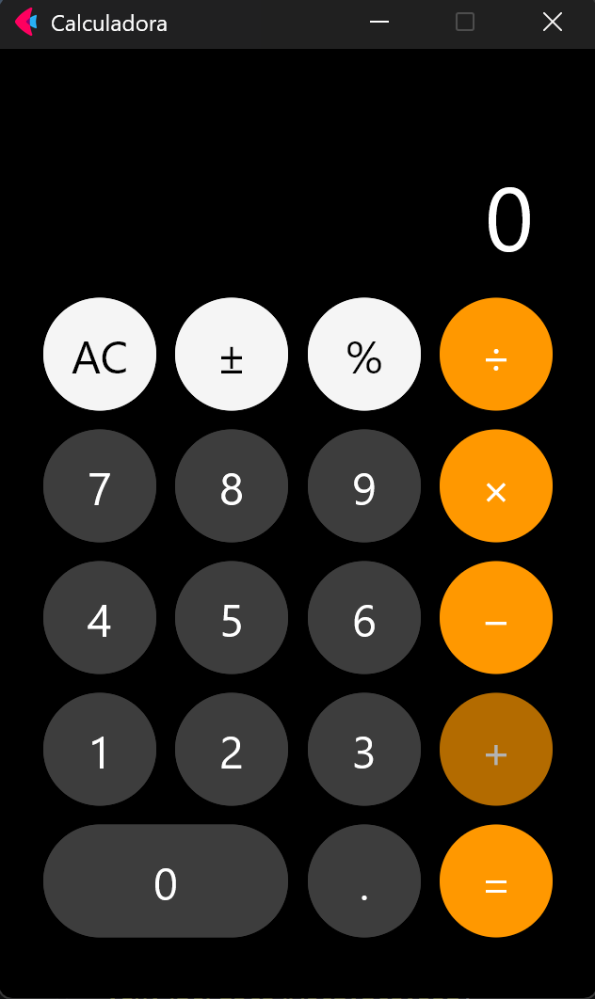

# Calculadora

A desktop calculator built with Python and [Flet](https://flet.dev), styled after the iPhone calculator.

<!-- To add a screenshot: save it as screenshot.png in this folder and uncomment the line below -->
<!--  -->

## Features

- Basic operations: `+`, `−`, `×`, `÷`
- `±` (change sign), `%` (percentage) and `AC` (clear)
- Full keyboard support, including the numeric keypad
- Handles errors such as division by zero without crashing
- Display font shrinks automatically for long numbers
- Small, always-on-top window

## Keyboard shortcuts

| Key | Action |
|---|---|
| `0`–`9` | Digits |
| `+` `-` `*` `/` | Operators |
| `.` or `,` | Decimal point |
| `Enter` or `=` | Result |
| `%` | Percentage |
| `Backspace` | Delete last character |
| `Esc` or `Delete` | Clear (AC) |

## Running locally

Requires Python 3.10 or later.

```bash
git clone https://github.com/<your-username>/calculadora.git
cd calculadora

python -m venv .venv
.venv\Scripts\activate          # Windows
# source .venv/bin/activate     # macOS / Linux

pip install -r requirements.txt
python calculator.py
```

## How it works

The code is split into two parts inside `calculator.py`:

- **Logic** – plain functions (`process`, `calculate`, `format_value`) that take the current expression and the pressed key and return the new expression. They don't depend on the UI, so they can be tested on their own.
- **UI** – the `main` function builds the window with Flet: a display and a grid of round buttons generated from the `btn_head` and `btn_middle` lists.

Expressions are only evaluated after checking that they contain nothing but digits and operators.

## Built with

- Python
- Flet 1.x
